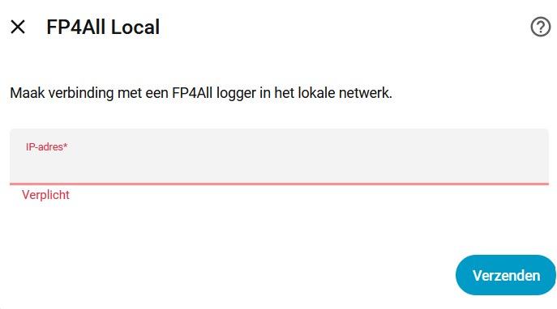
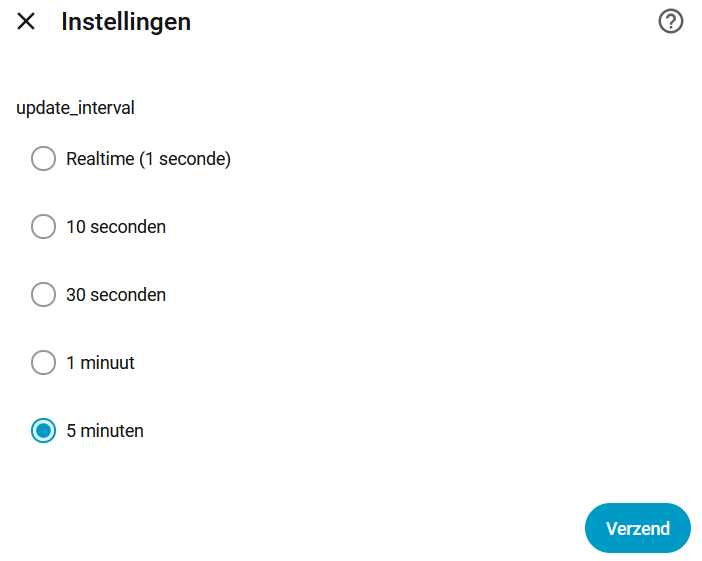
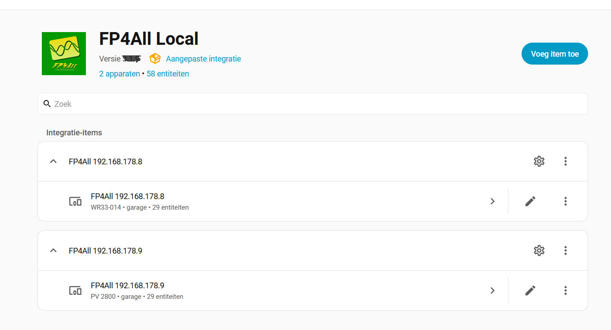
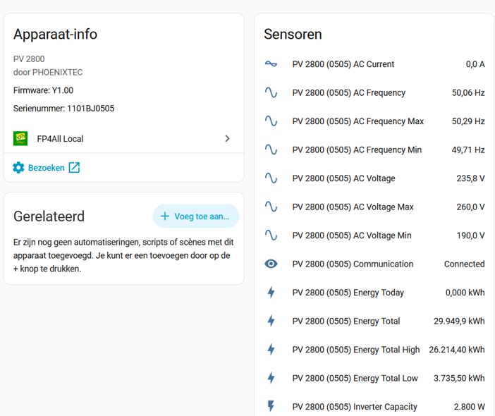
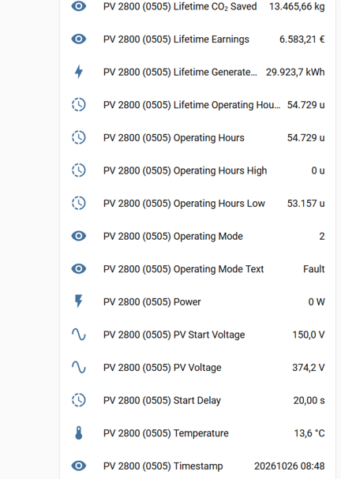

# FP4All Local voor Home Assistant

**Lokale, realtime Home Assistant-integratie voor FP4All PV-omvormerloggers — geen PVOutput vereist.**

[🇬🇧 English](#english) · [🇳🇱 Nederlands](#nederlands) · [Installation](#installation) · [Configuration](#configuration) · [Changelog](CHANGELOG.md) 

## 🇳🇱 Nederlands

FP4All Local maakt de lokaal beschikbare gegevens van een FP4All-logger rechtstreeks beschikbaar in Home Assistant. De integratie communiceert via het lokale netwerk met de webinterface van de logger. Een online dienst zoals PVOutput is hiervoor niet nodig.

De actuele gegevens kunnen worden gebruikt in dashboards, energieoverzichten en automatiseringen. Denk bijvoorbeeld aan het inschakelen van een elektrische verbruiker, laadpaal of warmtepomp wanneer er voldoende zonne-energie beschikbaar is. Houd bij het automatiseren rekening met de actualiteit en betrouwbaarheid van de gegevens.

De updatefrequentie is afhankelijk van de instellingen en mogelijkheden van de FP4All-logger. Deze kan variëren van realtime tot ongeveer iedere vijf minuten.

## Belangrijke voorwaarde bij het toevoegen van een logger

**De omvormer moet actief zijn en de FP4All-logger moet bereikbaar zijn wanneer je de logger aan Home Assistant toevoegt.**

Dit lukt normaal gesproken overdag, wanneer de omvormer actief is (meestal tussen zonsopkomst en zonsondergang). Als de omvormer niet actief is of de logger niet bereikbaar is, kan het toevoegen mislukken. Probeer het opnieuw zodra de omvormer actief is en de logger via het lokale netwerk bereikbaar is.

## Functies

- Rechtstreekse communicatie via het lokale netwerk met FP4All-loggers.
- Actuele omvormer- en energiegegevens in Home Assistant.
- Geen PVOutput-account of cloudverbinding nodig voor de lokale uitlezing.
- Meerdere FP4All-loggers kunnen worden toegevoegd.
- Herkenbare sensorvriendelijke namen met loggeradres en, indien beschikbaar, omvormertype en de laatste vier cijfers van het serienummer.
- Bestaande entity-ID's zijn bedoeld behouden te blijven bij verbeteringen aan Friendly Names.
- Laatst bekende geldige sensorwaarden blijven beschikbaar bij tijdelijke communicatiestoringen.
- Communicatiestatus geeft aan wanneer de logger niet bereikbaar is en wanneer verbinding is hersteld.
- Cachegegevens worden bewaard via Home Assistant Storage (`.storage`), in plaats van in een cachemap binnen de integratie.

## Installatie

### Via HACS

Als FP4All Local beschikbaar is in de standaardlijst van HACS:

1. Open HACS in Home Assistant.
2. Zoek naar **FP4All Local**. Als de integratie nog niet in jouw HACS-overzicht staat, voeg dan de repository als custom repository toe met categorie **Integration**.
3. Installeer FP4All Local.
4. Herstart Home Assistant als HACS daarom vraagt of nadat de installatie is afgerond.
5. Ga naar **Instellingen → Apparaten & diensten → Integratie toevoegen**.
6. Zoek naar **FP4All Local**.
7. Vul het lokale IP-adres van de FP4All-logger in.
8. Rond de configuratie af. Zorg dat de omvormer actief is en de logger bereikbaar is.

### Handmatige installatie

1. Maak eerst een back-up van Home Assistant.
2. Download het ZIP-bestand van de gewenste release.
3. Pak de inhoud uit. De map `fp4all` moet terechtkomen in:
   `config/custom_components/fp4all/`
4. Controleer dat `manifest.json` direct in die map staat.
5. Herstart Home Assistant.
6. Voeg **FP4All Local** toe via **Instellingen → Apparaten & diensten → Integratie toevoegen** en voer het lokale IP-adres van de logger in.

Vervang bij een upgrade de bestaande integratiemap zorgvuldig. Maak vooraf een back-up. Verwijder niet handmatig gegevens uit Home Assistant `.storage`.

### Configuratie stap voor stap

#### IP-adres van de FP4All-logger

Vul het lokale IP-adres in van de FP4All-logger die je aan Home Assistant wilt toevoegen. Zorg dat Home Assistant de logger via het lokale netwerk kan bereiken. De omvormer moet actief zijn en de logger moet bereikbaar zijn tijdens het toevoegen.

#### Scan-interval kiezen

Selecteer het gewenste scan-interval voor het ophalen van gegevens bij de logger. Een korter interval haalt vaker gegevens op; houd rekening met de mogelijkheden en belasting van de logger. De beschikbare keuzes worden bepaald door de integratieversie.

## Meerdere FP4All-loggers

Je kunt meerdere FP4All-loggers toevoegen via het configuratiescherm van de integratie. Voeg iedere logger afzonderlijk toe met het bijbehorende lokale IP-adres.

De integratie gebruikt apparaatinformatie om loggers en sensoren herkenbaar te maken. In de apparaatinfo kan onder andere het type, de firmwareversie van de FP4All-logger en het serienummer van de omvormer staan.

### Sensorherkenning

Voor herkenning wordt het omvormertype gecombineerd met de laatste vier cijfers van het serienummer, indien die informatie beschikbaar is.

Voorbeeld:

- Omvormertype: `PV 2800`
- Laatste vier cijfers serienummer: `0505`
- Herkenning: `PV 2800 (0505)`
- Sensor: `Energy Today`
- Voorbeeldwaarde: `0,100 kWh`

De voorbeeldwaarde is uitsluitend ter illustratie.

## Screenshots

### 1. Hoofdoverzicht en loggers toevoegen

Deze afbeelding toont de FP4All-sensoren in Home Assistant en het scherm waarmee je eventueel extra FP4All-loggers kunt toevoegen.

### 2. Apparaat- en sensorinformatie

De apparaatinformatie toont onder andere het type, de firmwareversie van de FP4All-logger en het serienummer van de omvormer. De herkenbare naam kan het omvormertype en de laatste vier cijfers van het serienummer bevatten.

### 3. Aanvullende sensorinformatie

Deze tweede afbeelding vult de sensorinformatie aan die niet op één afbeelding paste.

## Communicatieverlies en herstel

Wanneer de FP4All-logger tijdelijk niet bereikbaar is:

- blijven de laatst bekende geldige sensorwaarden beschikbaar voor zover ze zijn opgeslagen;
- geeft de integratie de communicatiestatus als verloren aan;
- kan de bedrijfsmodus als waarschuwing worden weergegeven.

Wanneer de verbinding terugkeert, haalt de integratie opnieuw actuele gegevens op en wordt de communicatiestatus hersteld.

De cache helpt bij tijdelijk communicatieverlies en bij een herstart van Home Assistant. De opgeslagen waarden zijn laatst bekende waarden en hoeven dus niet de actuele fysieke situatie weer te geven zolang communicatie ontbreekt.

## Opslag

Vanaf versie 3.1.12 gebruikt FP4All Local Home Assistant Storage (`.storage`) voor het bewaren van cachegegevens. De integratie gebruikt daarvoor de opslagvoorziening van Home Assistant. Cachebestanden worden niet langer als onderdeel van de integratiemap bijgehouden.

Maak bij updates altijd eerst een back-up. Verwijder of bewerk bestanden in `.storage` niet handmatig.

## Teststatus en hardwarecompatibiliteit

De integratie is oorspronkelijk ontwikkeld en getest met een oudere generatie FP4All-unit.

Versie 3.1.12 is door de maintainer getest met de beschikbare installaties, waaronder:

- bestaande installaties met meerdere loggers;
- normale uitlezing van beide omvormers;
- opslag en herstel van cachegegevens;
- herstart van Home Assistant;
- tijdelijk communicatieverlies en herstel;
- een nieuwe integratie-installatie;
- controle van het logboek, zonder gemelde fouten tijdens deze tests.

**Nieuwere generaties FP4All-loggers zijn niet afzonderlijk getest.** De webpagina's en bediening lijken op basis van visuele vergelijking sterk op die van de geteste generatie, maar dat is op zichzelf geen bewijs van compatibiliteit. De werking op nieuwere hardware blijft daarom onbevestigd totdat iemand die uitvoering daadwerkelijk test.

## Toekomstige uitbreidingen

De repository bevat voorbereidende bestanden die mogelijk als basis kunnen dienen voor latere uitbreidingen. Deze functionaliteit is nog niet actief of volledig uitgewerkt:

- **Historische energiegegevens:** verder onderzoek naar het ophalen en verwerken van historie, mogelijk tot ongeveer één jaar terug, afhankelijk van wat de logger aanbiedt.
- **Systeemmeldingen en foutcodes:** onderzoek naar het ophalen van waarschuwingen, storingen en eventuele tijdstippen.
- **Aanvullende statusinformatie:** onderzoek naar extra gegevens die de logger beschikbaar stelt.

Bestanden zoals `history.py`, `history_parser.py` en `fp4allstatus.py` worden voorlopig behouden als mogelijke basis voor deze uitbreidingen. Hun aanwezigheid betekent niet dat deze functies al beschikbaar zijn in de integratie.

## Problemen oplossen

1. Controleer of Home Assistant en de FP4All-logger elkaar via het lokale netwerk kunnen bereiken.
2. Controleer het IP-adres dat bij het toevoegen is ingevuld.
3. Controleer bij het eerste toevoegen of de omvormer actief is en de logger bereikbaar is.
4. Bekijk **Instellingen → Systeem → Logboeken** op meldingen van FP4All Local.
5. Herstart Home Assistant pas nadat je de logboekmelding hebt genoteerd, indien je een probleem onderzoekt.

## Veiligheid en beperkingen

- FP4All Local is een onafhankelijke community-integratie en geen officiële integratie van de fabrikant.
- De beschikbaarheid en betekenis van gegevens zijn afhankelijk van de logger, firmware en netwerkverbinding.
- Gebruik de integratie niet als enige bron voor veiligheidskritische of beschermende besturing.
- Lokale uitlezing vereist dat Home Assistant de logger via het netwerk kan bereiken.

## Versie

**FP4All Local 3.1.12**

Local · Realtime · No PVOutput required

---

## 🇬🇧 English

**Local, realtime Home Assistant integration for FP4All PV inverter loggers — no PVOutput required.**

FP4All Local makes data available from an FP4All logger directly accessible in Home Assistant. The integration communicates with the logger's web interface over the local network. No online service such as PVOutput is required.

The current data can be used in dashboards, energy views, and automations. For example, solar production data may be used to control an electrical load, EV charger, or heat pump when sufficient solar energy is available. Consider data freshness and reliability when building automations.

The update interval depends on the FP4All logger's settings and capabilities. It may range from realtime updates to approximately every five minutes.

## Important: the logger must be active during setup

**The inverter must be active and the FP4All logger reachable when adding it to Home Assistant.**

This is normally during daylight hours, when the inverter is active (usually between sunrise and sunset). Setup may fail if the inverter is inactive or the logger cannot be reached. Try again when the inverter is active and accessible over the local network.

## Features

- Direct local communication with FP4All loggers.
- Current inverter and energy data in Home Assistant.
- No PVOutput account or cloud connection required for local readings.
- Multiple FP4All loggers can be added.
- Readable sensor friendly names can include the logger address, inverter model, and last four digits of the serial number when available.
- Existing entity IDs are intended to remain unchanged when Friendly Names are improved.
- Last known valid sensor values remain available during temporary communication failures.
- Communication status indicates when the logger is unavailable and when communication is restored.
- Cache data is stored using Home Assistant Storage (`.storage`), not in a cache directory inside the integration folder.

## Installation

### Via HACS

If FP4All Local is available in the HACS default store:

1. Open HACS in Home Assistant.
2. Search for **FP4All Local**. If it is not listed in your HACS view, add the repository as a custom repository with category **Integration**.
3. Install FP4All Local.
4. Restart Home Assistant if requested by HACS or after installation.
5. Go to **Settings → Devices & services → Add integration**.
6. Search for **FP4All Local**.
7. Enter the FP4All logger's local IP address.
8. Complete setup. Make sure the inverter is active and the logger is reachable.

### Manual installation

1. Create a Home Assistant backup first.
2. Download the ZIP file from the desired release.
3. Extract it. The `fp4all` directory must be placed at:
   `config/custom_components/fp4all/`
4. Verify that `manifest.json` is directly inside that directory.
5. Restart Home Assistant.

## Configuration

6. Add **FP4All Local** via **Settings → Devices & services → Add integration** and enter the logger's local IP address.

Before upgrading, create a backup. Carefully replace the existing integration directory. Do not manually delete Home Assistant `.storage` data.

## Step-by-step configuration

#### FP4All logger IP address

Enter the local IP address of the FP4All logger you want to add to Home Assistant. Make sure Home Assistant can reach the logger over your local network. The inverter must be active and the logger must be reachable while adding the integration.

#### Choose the scan interval

Select the desired scan interval for retrieving data from the logger. A shorter interval retrieves data more frequently; take the logger's capabilities and workload into account. The available options depend on the integration version.

## Multiple FP4All loggers

You can add multiple FP4All loggers through the integration configuration screen. Add each logger separately using its local IP address.

Device information helps identify loggers and sensors. It may include the inverter type, FP4All logger firmware version, and inverter serial number.

### Sensor identification

When available, the inverter type is combined with the last four digits of the serial number.

Example:

- Inverter type: `PV 2800`
- Last four serial digits: `0505`
- Identifier: `PV 2800 (0505)`
- Sensor: `Energy Today`
- Example value: `0.100 kWh`

The value is illustrative only.

## Screenshots

### 1. Sensor overview and adding loggers

`screenshots/sensorenmain.png`

This image shows the FP4All sensors in Home Assistant and the screen used to add additional FP4All loggers.

### 2. Device and sensor information

`screenshots/sensoreninfo.png`

Device information may include the inverter type, FP4All logger firmware version, and inverter serial number. Readable names can include the inverter type and the last four serial digits.

### 3. Additional sensor information

`screenshots/sensoreninfo1.png`

This second image supplements the sensor information that did not fit in a single screenshot.

## Communication loss and recovery

When the FP4All logger is temporarily unavailable:

- the last known valid sensor values remain available where stored;
- the integration reports communication loss;
- the operating mode may be displayed as a warning.

When communication returns, the integration retrieves current data and restores the communication state.

The cache helps during temporary communication loss and Home Assistant restarts. Cached values are the last known values and may not represent the current physical situation while communication is unavailable.

## Storage

Starting with version 3.1.12, FP4All Local uses Home Assistant Storage (`.storage`) to retain cache data. It uses Home Assistant's storage facility. Cache files are no longer maintained inside the integration directory.

Always create a backup before upgrading. Do not manually edit or remove files in `.storage`.

## Testing and hardware compatibility

The integration was originally developed and tested with an older generation FP4All unit.

Version 3.1.12 has been tested by the maintainer with the available installations, including:

- existing installations with multiple loggers;
- normal readings from both inverters;
- cache storage and recovery;
- Home Assistant restart;
- temporary communication loss and recovery;
- a fresh integration setup;
- logbook checks, with no errors reported during these tests.

**Newer FP4All hardware generations have not been tested separately.** Their web pages and controls appear visually similar to those of the tested generation, but visual similarity alone does not prove compatibility. Compatibility with newer hardware remains unconfirmed until that hardware is tested.

## Future improvements

The repository contains preparatory files that may serve as a basis for future enhancements. These features are not active or fully implemented yet:

- **Historical energy data:** further investigation into retrieving and processing history, potentially up to approximately one year, depending on logger capabilities.
- **System messages and error codes:** investigation into retrieving warnings, faults, and any available timestamps.
- **Additional status information:** investigation of other data exposed by the logger.

Files such as `history.py`, `history_parser.py`, and `fp4allstatus.py` are being retained as potential foundations. Their presence does not mean these features are already available.

## Troubleshooting

1. Check that Home Assistant can reach the FP4All logger over the local network.
2. Verify the IP address entered during setup.
3. When adding the logger for the first time, make sure the inverter is active and the logger reachable.
4. Check **Settings → System → Logs** for FP4All Local messages.
5. If investigating an issue, note the log message before restarting Home Assistant.

## Safety and limitations

- FP4All Local is an independent community integration and is not an official manufacturer integration.
- Data availability and meaning depend on the logger, firmware, and network connection.
- Do not use this integration as the sole source for safety-critical or protective control.
- Local readings require Home Assistant to be able to reach the logger over the network.

## Version

**FP4All Local 3.1.12**

Local · Realtime · No PVOutput required
